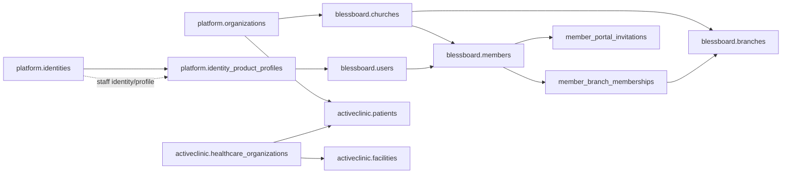
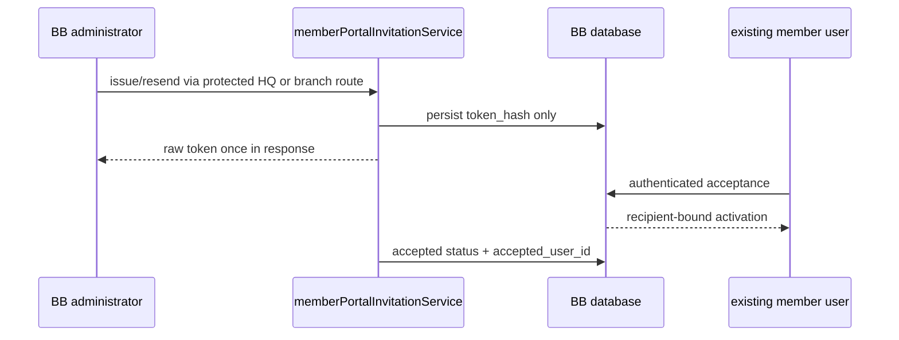

# V211 BlessBoard / ActiveClinic / Platform People Architecture Audit

## Scope and evidence

This is a read-only V11 source and test-coverage audit. HEAD is
`8df053e8b1a22e2d30c8b378101cfc155afcaa6a`; the isolated database
`getpro_v211_test_01` was queried read-only and contains
`platform.database_identity`, `blessboard.member_portal_invitations`,
`activeclinic.patients`, and `platform.identities`. Migration
`db/migrations/blessboard/129_member_portal_invitations.sql` is present.
No production database was accessed and no product code was changed.

The architecture conclusions below distinguish source evidence from inferred
or unverified behavior. Earlier QA reports were not treated as fresh
execution evidence.

## Executive summary

BlessBoard has a church-owned `blessboard.members` person/profile record,
optionally linked to a `blessboard.users` login principal. Its memberships are
branch-specific and it now has a dedicated, hash-only member portal invitation
contract. Staff/admin authorization uses the catalogue
`blessboard.user_role_assignments`; ordinary member portal scope is resolved
from an active member and active branch membership.

ActiveClinic patients are healthcare records, not login principals. They are
owned by an organization and healthcare organization and are linked to
clinical, booking, billing and facility data. ActiveClinic authentication is
based on `platform.identities`, with product profiles and staff assignments;
patient portal/guest booking flows are separate from staff access. No evidence
supports merging BB members and AC patients into one business table.

Platform already owns identity primitives, deployment sessions, identity action
tokens, product-profile links, organization/product catalogue and common
CSRF/session helpers. The transition is incomplete: BlessBoard credentials
remain on `blessboard.users`, while ActiveClinic credentials use
`platform.identities`. This is the principal consolidation risk, not a reason
to merge domain records.

## Source-backed model





## BlessBoard inventory

Core tables and relationships:

- `blessboard.members`: `church_id`, nullable `user_id`, normalized contact,
  `status` (`pending`, `active`, `inactive`, `suspended`, `archived`) and
  irreversible archive trigger. Live per-church email and phone uniqueness
  indexes provide database duplicate protection.
- `blessboard.member_branch_memberships`: `member_id`, `branch_id`,
  `membership_status` (`pending`, `active`, `inactive`), one primary
  membership, and a trigger requiring branch/church consistency.
- `blessboard.member_registrations`: branch-scoped intake with optional
  `member_id`, reviewer and review timestamps; the schema explicitly supports
  no automatic account creation.
- `blessboard.users`: product-era BB login account and credential owner.
- `blessboard.user_role_assignments` plus `blessboard.roles`: staff/admin
  catalogue authorization. Ordinary member scope is not a staff role.
- `blessboard.member_portal_invitations`: organization/church/branch/member
  ownership, `recipient_user_id`, `token_hash`, status, expiry, issuer,
  acceptance and revocation audit fields. The only token column is a fixed
  64-character hash; raw tokens are generated in
  `memberPortalInvitationService.js` and returned once.

Routes and services:

- Registration/intake: `src/blessboard/services/memberRegistrationService.js`,
  `src/blessboard/http/membershipWorkflowAdminRoutes.js`,
  `src/blessboard/http/tenantRegistrationRoutes.js`,
  `src/blessboard/http/pathPublicChurchActionRoutes.js`.
- HQ and branch member invitation management:
  `src/blessboard/http/memberPortalInvitationAdminRoutes.js`, mounted at
  `/hq/members/:id/invitation` and `/branch-admin/members/:id/invitation`.
- Acceptance: `src/blessboard/http/memberPortalInvitationAcceptRoutes.js`,
  `GET/POST /member-invite/accept`; acceptance delegates to
  `memberPortalInvitationAcceptanceService.js`.
- Portal access: `src/blessboard/http/memberPortalRoutes.js`,
  `memberPortalService.js`, `requireActiveMemberForTenant.js`.
- Authorization/context: `loadBlessBoardAuthorizationContext.js`,
  `blessBoardRbacAuthorizationService.js`, catalogue role assignments.
- Audit: `recordBlessBoardAudit.js` and platform/church audit infrastructure.

The current invitation contract is deliberately separate from legacy staff
invitations (`blessboard.user_invitations`). Issue, resend, revoke, recipient
binding, one-time consumption, CSRF, no-store and no-referrer behavior are
covered by the BB-11 implementation and focused browser tests. The main
contract boundary is that an invitation is not an account-creation workflow:
the member must already have a bound existing user.

## ActiveClinic inventory

Core tables and relationships:

- `activeclinic.patients`: organization and healthcare-organization ownership,
  collision-safe `patient_number`, demographic/contact data, lifecycle status,
  creator/updater staff FKs, and composite organization ownership constraints.
  It is not a login principal and has no `platform_identity_id` column.
- `activeclinic.healthcare_organizations`: healthcare tenant boundary.
- `activeclinic.facilities` and related facility assignment tables: operational
  clinic/facility scope. Patient clinical records use organization/HCO/facility
  ownership constraints as appropriate.
- `activeclinic.staff_members`: staff profile, linked to
  `platform.identities`; staff access is role/facility scoped.
- `activeclinic.public_booking_requests` and guest-token/linkage services:
  guest bookings remain unlinked or become review candidates; exact matches do
  not silently auto-link a patient.
- Patient registration and matching are implemented in
  `src/activeclinic/services/patientRegistrationService.js`,
  `patientMatchingService.js` and booking/linkage services; exact filenames
  vary by workflow and are enumerated by the matching tests below.

Observed workflows include staff-created/quick-registered patients,
duplicate/matching review, guest booking, explicit staff linking, patient
portal/guest account conversion, facility isolation, and clinical-record
privacy. The patient-registration and booking tests establish that a possible
match is not an automatic link. ActiveClinic staff invitation and recovery
workflows use platform identity services and remain distinct from BB member
invitations.

Patient login and portal authorization are not the BB member contract:
ActiveClinic uses platform identity/deployment-session infrastructure and
product/facility authorization. The exact patient portal account contract is
partially distributed across booking, portal and identity services; no source
evidence justifies treating it as equivalent to BB `portal_access_status`.

## Platform inventory and ownership classification

| Capability | Classification | Evidence |
|---|---|---|
| Global identity record | PLATFORM_OWNED | `platform.identities`, `createPlatformIdentity` |
| Product profile link | PLATFORM_OWNED | `platform.identity_product_profiles` |
| BB credential/account | BB_OWNED / LEGACY | `blessboard.users`, BB auth services |
| AC staff credential/account | AC via PLATFORM | `platform.identities`, AC staff services |
| Deployment sessions | PLATFORM_OWNED | `platform.deployment_sessions`, session services |
| BB V5 sessions | BB_OWNED / LEGACY TRANSITION | `createV5Session`, BB session middleware |
| CSRF primitives | SHARED PLATFORM HTTP | V5 and ActiveClinic CSRF helpers |
| Identity action tokens | PLATFORM_OWNED | `platform.identity_action_tokens` |
| BB member invitations | BB_OWNED | `member_portal_invitations` and service |
| AC staff invitations | AC_OWNED using platform identity | AC staff invitation repository/services |
| Tenant/role catalogue | PLATFORM/BB SHARED | platform catalogue plus BB authorization |
| Clinical patient record | AC_OWNED | `activeclinic.patients` and clinical FKs |
| Delivery/notifications | DUPLICATED / PARTIAL | BB notification catalogue and AC delivery/status adapters |
| Cross-product profile isolation | PLATFORM contract | product key/profile type constraints |

Important gaps: `identity_product_profiles.profile_type` currently allows
`blessboard_user` and `activeclinic_staff`, not an AC patient profile. That is
consistent with patients being domain records, but makes a patient portal
identity contract a documented missing/uncertain capability rather than
something to infer.

## Comparison and risk classification

| Concern | BB member | AC patient | Classification |
|---|---|---|---|
| Creation | Church member/intake workflows | HCO patient registration/quick register | ESSENTIAL_DOMAIN_DIFFERENCE |
| Identity | Optional BB user link | Patient record, no login FK | ESSENTIAL_DOMAIN_DIFFERENCE |
| Authentication | BB V5 user/session/member scope | Platform identity/session for staff and separate portal/guest flows | JUSTIFIED_IMPLEMENTATION_DIFFERENCE |
| Activation | Existing-user-bound, recipient-bound invitation | Patient registration/linking and guest conversion | ESSENTIAL_DOMAIN_DIFFERENCE |
| Duplicate control | Live per-church contact unique indexes | Patient matching/review and HCO patient number | JUSTIFIED_IMPLEMENTATION_DIFFERENCE |
| Scope | Church plus multi-branch memberships | Organization/HCO/facility and clinical record boundaries | ESSENTIAL_DOMAIN_DIFFERENCE |
| Roles | BB catalogue staff roles vs member scope | AC staff roles/facilities; patient is not staff | ESSENTIAL_DOMAIN_DIFFERENCE |
| Credentials | BB product-owned during transition | Platform-owned for AC staff | CONTRACT_INCONSISTENCY |
| Invitations | BB hash-only member invitation and legacy staff invitation | AC staff invitation/recovery contracts | UNNECESSARY_DUPLICATION at primitive level; workflows remain domain-specific |
| Privacy | Church member profile | Clinical/health data | SECURITY_RISK if generalized into one profile/table |
| Recovery/deactivation | BB member/user/session and status contracts | AC identity/staff/patient/clinical contracts | NOT_VERIFIED as a single shared lifecycle |

Primary security risks are transition complexity (two credential stores and
two session families), accidental cross-product identity/profile linking,
confusing a patient with a staff identity, and leaking sensitive clinical
attributes into a shared identity record. The invitation implementation itself
uses hash-only persistence and recipient binding; no raw-token database
storage was found.

## Consolidation recommendations

1. **P0 / HIGH / safe milestone: maintain the product isolation contract.**
   Keep `members` and `patients` separate. Make shared authorization APIs
   explicitly accept product key, organization/HCO scope and subject type.
   Retain BB church/branch rules and AC HCO/facility/clinical rules. Migration:
   none; test impact: cross-product denial and privacy regression suite.
2. **P1 / HIGH / V11+ identity convergence: converge credential ownership.**
   Existing BB `blessboard.users` and AC `platform.identities` should converge
   through an explicit, reversible identity-link/cutover contract. Preserve BB
   user IDs and patient records; do not copy password hashes. Require verified
   contact, conflict handling, session rotation/revocation and audit. Migration:
   staged backfill/link table and dual-read period; authorization impact high.
3. **P1 / MEDIUM / V11+: standardize opaque session and CSRF contracts.**
   Keep product-specific authorization context but share session token hashing,
   cookie attributes, rotation and logout/revocation primitives. Do not merge
   tenant context or cookies without a product-bound subject check.
4. **P1 / MEDIUM: extract token lifecycle primitives only.**
   Standardize hash/TTL/single-use/replay/audit mechanics in Platform while
   retaining BB member and AC staff invitation tables and recipient rules.
   Never create a generic person invitation table containing clinical data.
5. **P2 / MEDIUM: shared notification delivery interface.**
   Keep templates, consent, recipient selection and clinical privacy product
   owned; share provider adapter, delivery state, retry and redaction rules.

## Test coverage audit

Freshly executed (read-only/static) command:

```text
node --test tests/blessboard-v5-server-query-audit.test.js tests/v2-02-legacy-rbac-removal.test.js
```

Result: 9 pass, 0 fail, 0 skip. The local database identity was checked
read-only; no broad integration suite was run because those suites provision
and mutate fixtures.

| Area | Actual tests/evidence | Status |
|---|---|---|
| BB member registration/duplicates/linking | `tests/blessboard-member-journey-foundation.test.js`, `tests/blessboard-registration-duplicate-*`, `tests/blessboard-phone-identity-foundation.test.js` | TEST_EXISTS; NOT_RUN_THIS_AUDIT |
| BB invitation lifecycle/acceptance | `tests/v211-member-invitation-*.test.js`, `tests/v211-member-portal-invitation-*.test.js`, saved HQ/branch/acceptance Playwright specs | TEST_EXISTS; prior focused PASS, not rerun here |
| BB member login/legacy portal | `tests/blessboard-member-portal.test.js`, `tests/church-auth.test.js`, `tests/church-branch-member-directory.test.js` | TEST_EXISTS; NOT_RUN_THIS_AUDIT |
| BB HQ/branch workflows | `tests/v8-bb-membership.test.js`, `tests/v8-bb-hq-membership-route.test.js`, branch admin suites | TEST_EXISTS; NOT_RUN_THIS_AUDIT |
| AC patient creation/duplicates | `tests/activeclinic-patient-registration-rbac.test.js`, `tests/activeclinic-booking-patient-linkage.test.js` | TEST_EXISTS; NOT_RUN_THIS_AUDIT |
| AC guest booking/matching | `tests/activeclinic-mf10-booking.test.js`, `tests/activeclinic-booking-patient-linkage.test.js` | TEST_EXISTS; NOT_RUN_THIS_AUDIT |
| AC patient/clinical isolation | `tests/activeclinic-clinical-foundation.test.js`, `activeclinic-booking-patient-linkage.test.js` | TEST_EXISTS; NOT_RUN_THIS_AUDIT |
| AC staff login/session/facility isolation | `tests/activeclinic-unified-login.test.js`, `activeclinic-application-shell.test.js`, facility parity suites | TEST_EXISTS; NOT_RUN_THIS_AUDIT |
| Shared identity/session/CSRF | `tests/activeclinic-unified-login.test.js`, `tests/activeclinic-hosted-auth-qa-safety.test.js`, V5 session tests | TEST_EXISTS; NOT_RUN_THIS_AUDIT |
| Cross-product isolation | `tests/activeclinic-product-isolation.test.js`, platform RBAC convergence tests | TEST_EXISTS; NOT_RUN_THIS_AUDIT |
| Migration compatibility | migration/schema tests and product foundation suites | TEST_EXISTS; NOT_RUN_THIS_AUDIT |
| Browser workflows | saved BB-11 invitation specs; AC browser coverage is distributed/partial | BB focused PASS previously; AC NOT_VERIFIED |

Critical paths still requiring a fresh full run are AC patient portal identity
semantics, BB-to-platform credential cutover behavior, cross-product identity
collision handling, migration rollback/compatibility, and browser coverage for
AC patient workflows. These are `NOT_RUN` or `NOT_VERIFIED`, not passes.

## Readiness

The audit is ready as an architecture artifact, not a claim of full V11
release qualification. BB-11 invitation browser gates were previously saved
and passed, but this audit did not rerun them. V11 commit readiness is
**NOT_READY** until the focused and full regression evidence is assembled,
the credential transition contract is accepted, and AC patient portal
ownership is explicitly specified. Production readiness is **NOT_READY** for
the same reasons plus missing fresh full-suite evidence.

## BB-11F3 regression evidence update

Fresh controlled local execution used `getpro_v211_test_01` and no production
database. The three saved BB browser suites passed **3/3**. The focused BB
invitation/activation node suite passed **37/37**. The selected BB
member/staff regression suites passed **48**, failed **0**, and skipped **7**;
the skips are host-dependent cases in the existing church auth/branch-admin
tests, not newly introduced failures.

Selected ActiveClinic patient/identity suites passed **55/55**. Selected
Platform identity/session/RBAC suites passed **40/40**. The architecture
static suite passed **9/9**. No product regression was found in these
controlled selections. Full-repository regression, skipped host-dependent
church cases, and broader AC patient browser coverage remain `NOT_RUN` or
`SKIPPED`; they are not represented as full release qualification.
